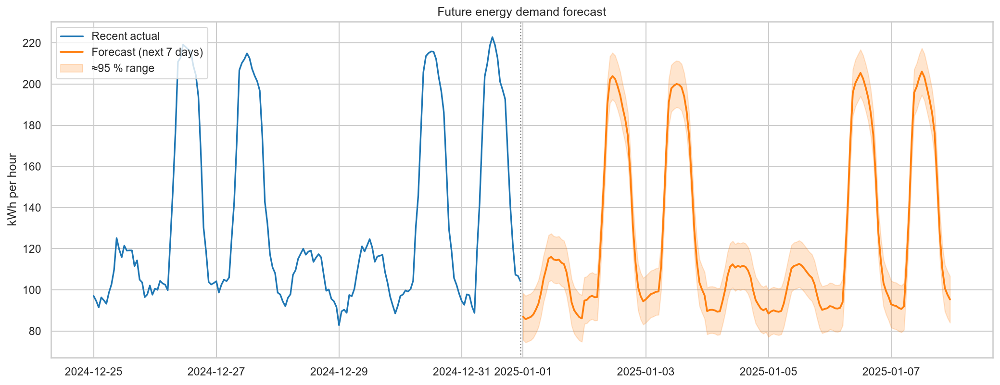
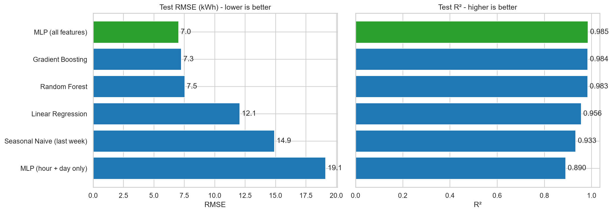
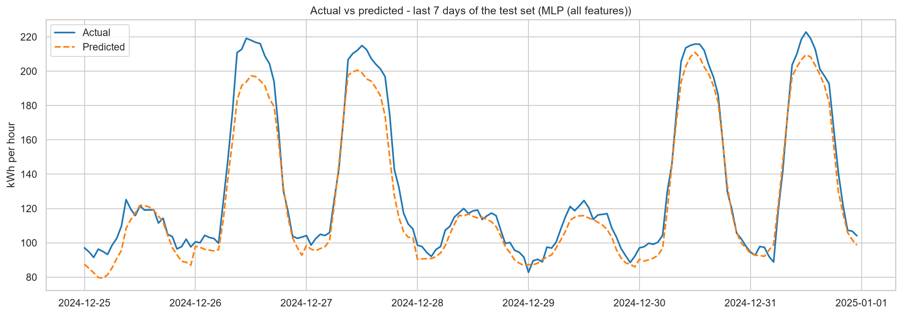
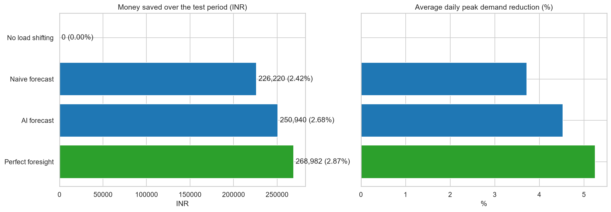

# ⚡ AI-Powered Energy Consumption Forecasting

Forecast a building's **hourly electricity demand for the next 7 days** with machine learning, serve it through a REST API,
and measure what a better forecast is worth in money and peak demand.



> **Dataset note:** real utility data is private, so this project runs on a **virtual smart-meter dataset** that simulates a commercial building
> (office hours, weekends, holidays, air-conditioning, yearly growth) and is deliberately made messy (missing hours, duplicates, sensor spikes).
> Scores therefore show the *pipeline* works; they are not claims about real buildings. Any CSV with `Datetime, Energy[, Temperature]` can be used instead.

## Problem statement

Electricity cannot be stored cheaply, so grids, buildings and factories must guess future demand. Guess too low and you risk shortages or
expensive emergency power; guess too high and you waste fuel and money. This project predicts demand so that peaks can be shaved and flexible load moved to cheaper hours.

## Industry relevance

| Sector | How forecasting helps |
|---|---|
| Smart cities / grids | plan generation, avoid overload and blackouts |
| Electricity boards / utilities | buy power ahead of time, schedule plants |
| Manufacturing plants | avoid peak-demand charges, schedule heavy machines |
| Data centers | plan cooling and capacity |
| Renewable energy | balance variable solar/wind with expected demand |
| Commercial buildings | pre-cool, charge batteries, cut the bill |

## Tech stack

Python 3.10+ · pandas · NumPy · scikit-learn (Linear, MLP, Random Forest, HistGradientBoosting) · Matplotlib · Seaborn · joblib · Flask · pytest

## Pipeline

```
Raw CSV → Cleaning → Feature engineering → Train & compare 6 models → Best model → 7-day forecast → Cost simulation
                                                                           └────→ Flask API
```
Details: [docs/architecture.md](docs/architecture.md) · [docs/simulation.md](docs/simulation.md)

## Results (test set = last 20 % of the timeline, never seen in training)

| Model | RMSE (kWh) | MAE (kWh) | R² | MAPE |
|---|---|---|---|---|
| **MLP (all features)** | **7.03** | **5.53** | **0.985** | 3.9 % |
| Gradient Boosting | 7.33 | 5.64 | 0.984 | 4.0 % |
| Random Forest | 7.60 | 5.75 | 0.983 | 4.0 % |
| Linear Regression | 12.06 | 7.89 | 0.956 | 5.8 % |
| Seasonal Naive (same hour last week) | 14.92 | 8.68 | 0.933 | 6.1 % |
| MLP (hour + weekday only) | 19.12 | 12.85 | 0.890 | 7.9 % |

**Take-aways**

* The simple "hour + weekday" MLP is *worse than the naive baseline*. Temperature, holidays and day-ahead lags reduce its error by about 63 %.
* The top three models are close, so pick on simplicity, speed and stability too.




### Business simulation (217 test days, time-of-use tariff + demand charge)

| Strategy | Peak hours identified | Bill saved | Daily peak reduced |
|---|---|---|---|
| Naive forecast | 77 % | 2.42 % | 3.72 % |
| **AI forecast** | **86 %** | **2.68 %** | **4.53 %** |
| Perfect foresight (ceiling) | 100 % | 2.87 % | 5.25 % |



More charts: [energy overview](images/01_energy_overview.png) · [daily profile](images/02_hourly_profile.png) ·
[temperature effect](images/03_temperature_vs_energy.png) · [heatmap](images/04_weekday_hour_heatmap.png) ·
[residuals](images/08_residual_analysis.png) · [feature importance](images/09_feature_importance.png)

## Installation

Requires Python 3.10 or newer.

**Windows (PowerShell)**
```powershell
git clone https://github.com/<your-username>/ai-energy-consumption-forecasting.git
cd ai-energy-consumption-forecasting
python -m venv .venv
.venv\Scripts\activate
pip install -r requirements.txt
```
**macOS / Linux**
```bash
git clone https://github.com/<your-username>/ai-energy-consumption-forecasting.git
cd ai-energy-consumption-forecasting
python3 -m venv .venv
source .venv/bin/activate
pip install -r requirements.txt
```

## Usage

```bash
python main.py                      # full pipeline (about 1 minute): clean → train → forecast → charts → simulation
python main.py --regenerate         # create a new virtual dataset first
python main.py --data my_data.csv   # use your own hourly data (columns: Datetime, Energy[, Temperature])
python main.py --horizon 72         # forecast 72 hours instead of 168
python -m pytest -q                 # run the tests
jupyter notebook notebooks/         # step-by-step walkthrough
```

Outputs: `images/` (charts), `outputs/` (CSV tables and training log), `models/best_model.joblib`.

### REST API

```bash
python app.py
curl http://127.0.0.1:5000/health
curl "http://127.0.0.1:5000/forecast?hours=24"
curl -X POST http://127.0.0.1:5000/predict -H "Content-Type: application/json" -d '{"datetime": "2025-01-02 10:00"}'
```
Response: `{"datetime": "2025-01-02 10:00", "predicted_energy_kwh": 202.21}`
(On Windows PowerShell use `curl.exe`, or test with Postman.)

## Project structure

```
ai-energy-consumption-forecasting/
├── data/raw/energy.csv           virtual smart-meter data (messy on purpose)
├── data/processed/               cleaned hourly series
├── notebooks/                    step-by-step walkthrough notebook
├── src/                          config · data_generation · data_loader · features · models
│                                 train · evaluate · forecast · simulation · visualize
├── models/best_model.joblib      saved model bundle
├── outputs/                      metrics, forecast, simulation tables, training log
├── images/                       charts for the README
├── docs/                         architecture · simulation · github guide · interview prep
├── tests/                        pytest unit tests
├── app.py                        Flask API
├── main.py                       one-command pipeline
└── requirements.txt
```

## Key engineering decisions

* **Chronological split** (train on the past, test on the future) instead of a shuffled split.
* **Day-ahead-safe features**: the shortest lag is 24 h, so nothing the forecast needs is unknown a day earlier.
* **Baseline first**: every model is compared with "same hour last week".
* **One feature function** for training and serving, so the API cannot drift from the training code.
* **Uncertainty band** around the forecast from test-set residuals.

## Limitations

* Simulated data; one building. Real data needs real validation.
* Future temperature uses a historical (month, hour) average; use a weather forecast in production.
* The ±95 % band is a simple normal approximation.
* No hyper-parameter search or probabilistic model yet.

## Ideas for next steps

Real dataset (e.g. a public hourly building or household load dataset) · real weather forecasts · quantile models for prediction intervals ·
LSTM / temporal models only if they beat boosting · scheduled retraining and drift monitoring · Streamlit dashboard.

## Learning outcomes

Time-series data cleaning · leakage-free validation · feature engineering with lags and cyclical encoding · model comparison and metrics ·
recursive multi-step forecasting · serving a model with Flask · translating model accuracy into business value · structuring a GitHub project.

## License

MIT - see [LICENSE](LICENSE).
